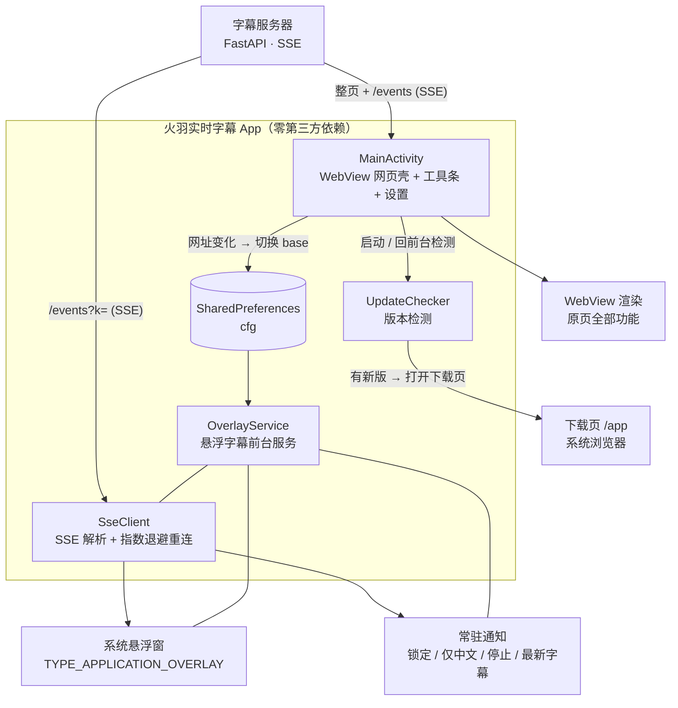

<div align="center">

# 火羽实时字幕 · Android 客户端

**把直播实时翻译字幕从「只能在网页里看」，变成「浮在手机任何应用之上」。**

全屏看直播、刷别的 App、甚至熄屏——中文字幕始终贴在屏幕上。


</div>

---

## 目录

- [项目简介](#项目简介)
- [功能特性](#功能特性)
- [快速开始](#快速开始)
- [使用技巧](#使用技巧)
- [进阶功能](#进阶功能)
- [技术实现](#技术实现)
- [自行编译](#自行编译)
- [权限说明](#权限说明)
- [版本记录](#版本记录)
- [常见问题](#常见问题)
- [安全提醒](#安全提醒)

---

## 项目简介

本项目把直播字幕网页（`http://<字幕服务器>:6006/?k=<口令>`）封装成安卓 App，并**额外实现了网页做不到的悬浮字幕**：

字幕不再被限制在网页内，而是通过系统级悬浮窗直接绘制在屏幕上，可以浮在任何 App 之上。你可以用任意播放器全屏看直播，翻译字幕依旧实时贴着屏幕滚动。

**设计取向：零第三方依赖。** 只使用系统内置的 `WebView` / `WindowManager` / `org.json`，不引入任何第三方库——APK 体积小、无供应链风险、不依赖网络仓库即可编译。

---

## 功能特性

| 功能 | 说明 |
|---|---|
| 🖥 **网页壳** | 全屏 WebView 加载原字幕页，视频小窗、翻译、TTS、发弹幕等原有功能全部保留 |
| 💬 **悬浮字幕** | 前台服务 + 系统悬浮窗，独立订阅字幕推送流，**浮在其它应用上层** |
| 🇯🇵 **中日对照** | 中文翻译大字 + 日文原文小字，可一键切换「仅中文」 |
| 👆 **可拖动** | 按住字幕任意位置拖到屏幕任意角落，位置自动记忆 |
| 🎚 **可调样式** | 字号 11–40、显示 1–4 行、背景不透明度 0–255，实时生效 |
| 🎨 **颜色与字体** | 中文 / 日文各一套颜色（预设色板 + RGB 滑杆取色）、7 种系统字体、可导入手机里的 `.ttf` / `.otf` 自定义字体、中文加粗开关，改完立即生效 |
| 🔒 **锁定穿透** | 锁定后字幕区域不拦截触摸，边看视频边操作不会误碰 |
| 🔔 **通知栏控制** | 常驻通知内直接「锁定 / 仅中文 / 停止」，并实时显示最新一句字幕 |
| ♻️ **断线自愈** | 推送流断开自动重连（指数退避），直播恢复后字幕自动接续 |
| 🔀 **服务器自动切换** | 网页地址跳到白名单服务器时，字幕服务器地址自动跟着切过去并立即重连 |
| ⬆️ **版本检测升级** | 每次打开 App 向当前服务器查询最新版本，有新版弹窗提醒，一键进入下载页 |
| 💾 **保存本场字幕** | 一键导出本场**全部**「中文翻译 + 日文原文」到手机「下载」目录，7 种格式（TXT 中日对照 / 纯中文 / 带时间 / SRT / CSV / Markdown / JSON） |

---

## 快速开始

### 安装

1. 从[字幕服务器下载页](http://123.60.104.22:6006/app)获取 `火羽实时字幕-*.apk`，传到手机（微信 / QQ / 数据线均可）。
2. 首次安装需允许「安装未知来源应用」。
3. 打开 App → 点顶部 **开启悬浮字幕** → 系统跳转权限页 → 允许 **显示在其他应用上层**。
4. 回到 App，悬浮字幕立刻出现。

> 首次启动会在顶部请求通知权限（Android 13+），用于展示字幕状态与快捷操作，建议允许。

### 基本使用

- App 启动后自动加载字幕页，网页内功能与浏览器访问完全一致。
- 点顶部 **开启悬浮字幕** 后，即可切到任意应用（含全屏播放器）看到实时字幕。
- 顶部工具条：**开启/关闭悬浮字幕** · **重载** · **设置**。

---

## 使用技巧

| 操作 | 效果 |
|---|---|
| 按住字幕拖动 | 移动到屏幕任意位置，松手自动记忆 |
| 轻点字幕一下 | 展开控制条 `A−` `A+` `中日` `2行` `锁定` `✕`，6 秒后自动收起 |
| 点「锁定」 | 字幕不再吃触摸，可放心操作下面被遮住的界面 |
| 拉下通知栏点「解锁」 | 恢复可拖动 / 可调字号 |
| 通知栏「仅中文」 | 快速切换中日对照 / 仅中文 |
| 关闭后重新点「开启悬浮字幕」 | 悬浮窗位置**复位到初始位置**（左侧 12dp、屏幕高度 60% 处） |
| 旋转手机（横竖屏切换） | 窗口按屏幕尺寸**等比换算位置**并约束在屏幕内，不会跑到屏幕外 |
| 设置 → 改「字幕服务器地址」「密钥 k」 | 复用同一 App 连接其它直播间 / 服务器 |
| 设置 → 改「中文颜色 / 日文颜色 / 字体」 | 悬浮字幕外观立刻变（不用重开悬浮窗） |

**收不到字幕？** 拉下通知栏看状态文字：

- `连接中…` —— 正在连接推送流
- `已连接 · N 人在看` —— 正常
- `重连中…` —— 网络或服务端断开，自动重试中

---

## 进阶功能

### 悬浮字幕样式（颜色 / 字体）

设置页 →「悬浮字幕样式」，改动**立即生效**，不需要关掉再开悬浮字幕：

| 项目 | 可选项 |
|---|---|
| 中文（翻译）颜色 | 12 色预设色板 + RGB 三条滑杆自由调色，对话框里实时预览 |
| 日文（原文）颜色 | 同上（默认灰白，弱化显示） |
| 字体 | 系统默认（黑体）/ 细体 / 中黑 / 特黑 / 宋体（衬线）/ 等宽 / 窄体，**外加从手机导入 `.ttf`、`.otf`** |
| 中文加粗 | 开 / 关（压在视频上更清楚，默认开） |

- 颜色只取不透明色，避免半透明字幕在浅色画面上看不清。
- 导入的自定义字体拷进应用私有目录（`files/fonts/`），原文件删了也不影响；再导入新字体会自动删掉旧的。
- 字体加载失败（文件损坏 / 不是字体）会自动回退系统字体，不会白屏或崩。
- 历史句子仍按原逻辑降透明度（62%），颜色配置对最新句与历史句同时生效。

### 保存本场字幕（导出翻译 + 原文）

点顶部工具条 **存字幕**（或 设置 → 保存本场字幕），选格式 → 保存：

```
GET {当前字幕服务器}/api/record?k=<口令>&kind=lines
→ {"meta":{...}, "n_lines":759, "n_dms":..., "lines":[{id,ja,zh,tc,t,ts,el}, ...]}
```

拿到的是**服务器留底的本场全量字幕**（从开播到现在），所以什么时候打开 App 都不影响——不会只存到「打开 App 之后」的那几句。

| 格式 | 内容 | 用途 |
|---|---|---|
| TXT · 中日对照 | `[已播 · 绝对时间] 中文` + 换行缩进日文 | 阅读 / 存档（默认） |
| TXT · 纯中文 | 每行一句译文 | 快速通读、喂给翻译/总结工具 |
| TXT · 中文 + 时间 | `[mm:ss.SSS] 中文` | 对轴、找时间点 |
| SRT · 双语 | 标准 SRT，中日各一行 | 直接当播放器**外挂字幕** |
| CSV · 表格 | `已播,时间,中文,日语`（带 UTF-8 BOM） | Excel / Numbers 直接打开不乱码 |
| Markdown · 表格 | 四列表格 | 贴进笔记、GitHub |
| JSON · 原始数据 | 服务端原样 `lines` 数组 | 二次处理 |

- 文件位置：**下载 / 火羽字幕 / 火羽字幕-YYYY-MM-DD_HHmm.txt**（重名自动加序号，旧版系统）。
- 权限：Android 10+ 走 MediaStore，**不需要任何存储权限**；Android 7.0–9 首次保存会申请一次「存储」权限。
- 换台 / 重新开播后，服务端记录会重置，导出即新的一场。
- 个别句子若在译文到达前就被记录，可能出现空行，稍后重存一次即可。

### 多服务器自动切换

App 内置一份字幕服务器白名单：

```
http://106.15.35.175:6006/
http://123.60.104.22:6006/
http://123.60.104.22:6007/
http://8.133.231.186:6006/
```

当 WebView 的网页地址发生变化（页面跳转、被重定向、单页应用 `pushState` 换地址，或用户手动跳转）时，App 会取出新地址的 `协议://主机:端口` 与白名单比对：

- **命中白名单且与当前服务器不同** → 自动把字幕服务器地址切换成新的这一个，同时同步 `k` 值，并让正在运行的悬浮字幕服务清空旧字幕、**立刻重连新服务器**。切换时屏幕弹提示，通知栏状态显示 `已切换服务器 · host:port`。
- **命中但与当前相同 / 不在白名单内** → 不做任何改动。

匹配只看 `协议://主机:端口`，路径与 `?k=` 参数不参与比较。

**开关**：设置 → 「网址变化时自动切换字幕服务器」（默认开启）。

### 版本检测与升级提醒

App 每次打开（启动、从后台回到前台、再次点图标）都会向**当前正在使用的字幕服务器**查询最新版本：

```
GET {当前字幕服务器}/api/version?k=<口令>      # 失败则回退尝试 /app/version
```

服务端返回的 `versionCode` 与本机已安装版本比较：

| 情况 | 行为 |
|---|---|
| 服务端版本更高 | 弹窗提醒：**「立即升级」** 用系统浏览器打开下载地址（`downloadUrl`，缺省 `{当前服务器}/app`）；**「稍后更新」** 关闭弹窗，下次打开仍会再提醒 |
| 已是最新 | 静默跳过 |
| 接口不存在 / 网络失败 / 非 JSON | **静默跳过**，不弹窗、不阻塞启动 |
| `force: true` 或本机低于 `minVersionCode` | **强制升级**：不显示「稍后更新」，返回键与点击外部都无法关闭 |

也可手动检查：**设置 → 「立即检查更新」**，会直接给出「已是最新版本」或具体失败原因。

> 📄 服务端接口规范见 [`docs/服务器端升级检测接口规范.md`](docs/服务器端升级检测接口规范.md)（含 FastAPI 参考实现与发版脚本）。
> 在服务器实现该接口之前，客户端会静默跳过检测，不影响任何已有功能。

---

## 技术实现

### 架构



### 目录结构

```
huoyu-sub-app/
├─ app/src/main/
│  ├─ AndroidManifest.xml
│  ├─ java/com/huoyu/livesub/
│  │  ├─ MainActivity.java      # WebView 壳、顶部工具条、设置、升级弹窗、存字幕入口
│  │  ├─ OverlayService.java    # 悬浮字幕前台服务（核心）
│  │  ├─ SseClient.java         # 手写 SSE 客户端（解析 + 重连）
│  │  ├─ UpdateChecker.java     # 版本检测
│  │  ├─ RecordExporter.java    # 本场字幕拉取（/api/record）+ 7 种格式生成
│  │  ├─ FileStore.java         # 写入「下载/火羽字幕」（MediaStore / 旧版目录）
│  │  ├─ ColorPicker.java       # 零依赖取色器（预设色板 + RGB 滑杆 + 预览）
│  │  └─ Prefs.java             # 配置项 + 服务器白名单 + URL 匹配 + 字体表
│  └─ res/
│     ├─ drawable/  mipmap-*/   # 应用图标、状态栏图标
│     └─ values/strings.xml
├─ docs/服务器端升级检测接口规范.md
├─ build_debug.bat              # 一键构建（Windows）
├─ build.gradle  settings.gradle  gradle.properties
└─ README.md
```

### 核心类职责

| 类 | 职责 |
|---|---|
| `MainActivity` | 全屏 WebView 承载原字幕页；顶部工具条（悬浮开关 / 重载 / 设置）；网址变化监听 → 自动切换服务器；启动版本检测与升级弹窗 |
| `OverlayService` | 前台服务（`foregroundServiceType=specialUse`）。创建 `TYPE_APPLICATION_OVERLAY` 悬浮窗、渲染中日对照字幕、拖动与边界限制、锁定穿透、通知栏快捷控制；接收 `ACTION_SWITCH` 在运行时热切换服务器 |
| `SseClient` | 纯 `HttpURLConnection` 实现的 SSE 客户端。逐行解析 `data:` 负载，断线指数退避重连（1s → 12s 封顶） |
| `UpdateChecker` | 请求 `/api/version`（回退 `/app/version`），解析版本信息；非 200 / 非 JSON / 无有效 `versionCode` 一律判定为不可用 |
| `RecordExporter` | 请求 `/api/record?kind=lines` 拿本场全量字幕，按 `id` 去重排序，生成 7 种导出格式（TXT/SRT/CSV/MD/JSON），时间轴优先用 `el`（已播秒）、缺省回退 `t` |
| `FileStore` | 落地到「下载/火羽字幕」：API 29+ 用 `MediaStore.Downloads` + `RELATIVE_PATH`（免权限），24–28 用公共下载目录 + 存储权限；重名自动加序号 |
| `ColorPicker` | 零依赖取色对话框：12 色预设 + R/G/B 三条 SeekBar + 示例实时预览；只输出不透明色 |
| `Prefs`（字体部分） | 7 种系统字体族表 + `typeface()` 重载：家族名不支持 / 自定义文件损坏时统统回退默认字体，绝不抛异常 |
| `Prefs` | 常量与配置键、服务器白名单、`originOf()` / `matchServer()` URL 归一化与匹配 |

### 字幕推送协议（SSE）

客户端订阅 `GET /events?k=<口令>`，常见事件：

| 事件 | 负载 | 用途 |
|---|---|---|
| `snapshot` | `{lines:[...]}` | 进入时下发历史字幕 |
| `line` | `{line:{id, ja, zh, t}}` | 新句；`ja` 先到，`zh` 译文稍后补上 |
| `line_upd` | `{id, zh}` | 补上某句的译文 |
| `status` | `{connected, viewers, msg}` | 连接状态、在线人数 |
| `reset` | — | 清空当前字幕 |
| `dm` / `dm_upd` / `move` / `guard` / `tts` | — | 与悬浮字幕无关，客户端忽略 |

渲染细节：中文行加粗大字、日文行小字降透明度，最新一句高亮，历史句降透明度；文字带描边阴影，压在视频画面上仍然清晰可读。

---

## 自行编译

### 环境要求

| 项目 | 版本 |
|---|---|
| JDK | 17 |
| Android SDK Platform | 34 |
| Android Build Tools | 34.0.0 |
| Gradle | 8.7（本项目未包含 Gradle Wrapper，需自备） |
| Android Gradle Plugin | 8.5.2 |

### 构建命令

```bash
cd huoyu-sub-app

# Windows：仓库自带脚本（内部已指定 JDK / Gradle / SDK 路径）
./build_debug.bat assembleDebug

# macOS / Linux：使用系统 gradle
gradle assembleDebug

# 产物
# app/build/outputs/apk/debug/app-debug.apk
```

> **注意**：`build_debug.bat` 中写死了本机的 JDK / Gradle / SDK 绝对路径，换环境时请按需修改。
> `local.properties` 记录本机 SDK 路径（`sdk.dir=...`），已被 `.gitignore` 排除；换机器后需自行创建，或设置环境变量 `ANDROID_HOME`。

### 打包发布版

```bash
gradle assembleRelease
```

发布前请记得同步更新 `app/build.gradle` 中的 `versionCode` / `versionName`，并让服务端 `/api/version`
返回相同的 `versionCode`、把 `/app` 下载文件替换为新包——否则客户端收不到升级提醒。

---

## 权限说明

| 权限 | 用途 | 必要性 |
|---|---|---|
| `INTERNET` / `ACCESS_NETWORK_STATE` | 访问字幕服务器、订阅推送流 | 必需 |
| `SYSTEM_ALERT_WINDOW` | 绘制悬浮字幕（核心能力） | 必需 |
| `FOREGROUND_SERVICE` / `FOREGROUND_SERVICE_SPECIAL_USE` | 熄屏、切后台后字幕持续接收 | 必需 |
| `POST_NOTIFICATIONS` | 通知栏快捷开关与状态显示 | Android 13+ 建议授予 |
| `WRITE_EXTERNAL_STORAGE` | 保存本场字幕到「下载」目录 | **仅 Android 7.0–9 需要**（清单里限 `maxSdkVersion=28`；10+ 走 MediaStore，无需权限） |
| `WAKE_LOCK` | 清单中已声明（预留；当前代码未显式持有 WakeLock） | 预留 |

---

## 版本记录

| 版本 | versionCode | 日期 | 内容 |
|---|---|---|---|
| **v1.5** | 6 | 2026-10-22 | 新增**悬浮字幕样式**：中文 / 日文颜色分别可调（12 色预设 + RGB 滑杆取色）、7 种系统字体 + 导入 `.ttf`/`.otf` 自定义字体、中文加粗开关，改动即时生效 |
| **v1.4** | 5 | 2026-10-22 | 新增**存字幕**：一键导出本场全部字幕（中文翻译 + 日文原文）到「下载/火羽字幕」，支持 TXT 中日对照 / 纯中文 / 中文+时间 / SRT 双语 / CSV / Markdown / JSON 共 7 种格式；数据取服务端留底（`/api/record`），不受打开 App 时间影响 |
| **v1.3** | 4 | 2026-10-16 | 修复：点「开启悬浮字幕」时把悬浮窗位置**重置回初始位置**（左侧 12dp、屏幕高度 60% 处）；修复**横竖屏切换后悬浮窗跑到屏幕外**——现按屏幕尺寸等比换算位置并强制约束在屏幕内 |
| **v1.2** | 3 | 2026-10-16 | 启动时检测新版本（`/api/version`），非最新弹窗提醒升级；新增「立即检查更新」入口；设置页显示当前版本 |
| **v1.1** | 2 | 2026-10-16 | 网址变化时自动切换字幕服务器（白名单匹配 + 同步 `k` + 无缝重连） |
| **v1.0** | 1 | 2026-10-15 | 首个版本：WebView 网页壳 + 悬浮字幕（中日对照 / 拖动 / 字号 / 行数 / 透明度 / 锁定穿透 / 通知栏控制 / 断线自愈） |

---

## 常见问题

<details>
<summary><b>开启悬浮字幕失败 / 看不到字幕</b></summary>

请确认已在系统设置中授予「**显示在其他应用上层**」（悬浮窗）权限。部分厂商 ROM（MIUI / ColorOS / EMUI 等）还需额外开启「后台弹出界面」「自启动」「省电白名单」，否则前台服务可能被系统杀掉。
</details>

<details>
<summary><b>通知栏一直显示「重连中…」</b></summary>

说明与字幕服务器的连接断开。可能是网络不稳定、服务器重启，或所在网络无法访问该服务器。客户端会自动指数退避重试；也可回 App 点「重载」。
</details>

<details>
<summary><b>点「立即升级」没反应 / 下载后装不上</b></summary>

升级通过系统浏览器打开下载页，需要浏览器具有「安装未知应用」权限，按系统提示开启即可。也可手动复制下载地址在电脑上下载后传到手机安装。
</details>

<details>
<summary><b>想连接别的直播间 / 别的服务器</b></summary>

设置 → 修改「**字幕服务器地址**」与「**密钥 k**」→ 保存。App 会立即用新地址重载网页并重连推送流。
</details>

<details>
<summary><b>字幕偶尔滞后一两句</b></summary>

字幕由服务端 ASR + 翻译后推送，译文通常比日文原文晚到一步，因此会出现短暂的「…翻译中」。这是链路固有延迟，非客户端问题。
</details>

---

## 安全提醒

> ⚠️ **公开仓库前请先处理以下事项。**

1. **默认口令内置于代码**：`Prefs.java` 中默认密钥 `k` 为公开值，随源码一起入库。若本仓库公开，等同于公开该口令，建议改为首次启动时让用户手动填写，或改用构建时注入。
2. **服务器地址硬编码**：白名单中的服务器 IP 与端口写死在 `Prefs.java`，公开后会暴露服务器地址。
3. **明文 HTTP 传输**：`AndroidManifest.xml` 中 `usesCleartextTraffic="true"`，且服务地址均为 `http://`，**通信内容未加密**（含口令）。仅适用于内网 / 自建服务器场景，切勿用于敏感数据。
4. **调试签名**：仓库产物为 debug 签名，仅用于自用分发，请勿直接上架应用商店。

---

## 相关文档

- [服务器端升级检测接口规范](docs/服务器端升级检测接口规范.md) —— 交给服务端实现的版本接口需求（含 FastAPI 参考实现、发版脚本、多镜像同步说明）

---

## License

本项目暂未指定开源许可证。如需公开，请先补充 `LICENSE` 文件（如 MIT / Apache-2.0）。
在未声明许可证前，默认保留所有权利。
